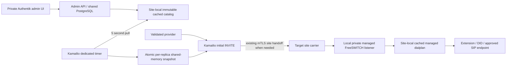

# AVoIP administration and managed routing

Implementation source is in this repository. Runtime activation is separate:
`avoipAdmin.enabled` creates administration resources on telephony sites;
`avoipAdmin.routing.enabled` independently opts into managed SIP routing. Existing
SIP routes remain the fallback for destinations outside the managed catalog.
Do not enable routing merely to obtain the management interface.

The owner is the existing
[AVoIP ApplicationSet](https://slop.writemy.codes/CoRE/CoRE-Backplane/src/branch/main/Apps/Business/AVoIP.yaml).
It supplies named carrier/private/WebSocket instances and site values. Both
`core-home1-talos-prod` (YVR/Home1) and `core-dc1-talos-prod` (YXL/DC1) run
FreeSWITCH. See [the current architecture](avoip/architecture.md),
[inter-site voice](INTERSITE-VOICE.md), [outbound policy](OUTBOUND-PILOT.md)
and [phone tree](PHONE-TREE.md) for the existing trust and call paths.

## Private site-local management

The default hostname is
`avoip-admin.<cluster>.<datacenter>.<region>.resolvemy.host`, configurable through
`avoipAdmin.hostname`. The private Gateway HTTPRoute uses the existing Authentik
outpost and grants access only to `flowrouteSMS.inbox.adminGroup`, normally
`AVoIP Admins`. It has no Forecastle annotations or public ExternalDNS label.
Optional `avoipAdmin.dns.enabled` publishes a DNS-only CNAME to the existing
site HTTPS gateway name specified by `avoipAdmin.dns.target`. The public DNS
metadata makes the hostname discoverable; it does not bypass Authentik. This
uses the existing ExternalDNS CRD source and its `wan-mode=public` selector on
a separate DNSEndpoint, never on the private HTTPRoute. DNSEndpoint has no BJW-S
resource class, so its custom API template is explicit. See
[ExternalDNS CRD source](https://github.com/kubernetes-sigs/external-dns/blob/master/docs/contributing/crd-source.md).
The API independently requires authenticated username and exact group membership.
Group headers are JSON generated by an Authentik property mapping and forwarded
through external authorization; refresh the Authentik session after changing
mappings or membership. The UI follows [the shared Material design spec](UI-DESIGN.md).

The UI/API on port 8080 is reachable through the authorized Gateway. Internal
routing uses a separate port 8081, site-local generated token and endpoint-specific
mux. NetworkPolicy admits that port only from local Kamailio and FreeSWITCH
workloads. The UI listener does not register machine routing endpoints. No pod
service-account token or write access to Kubernetes is needed.

All sites use the existing primary-region CoRE-Voice application's PostgreSQL
identity. The primary publishes its stable connection reference to Vault through
PushSecret; each site imports it with ExternalSecret. `avoipAdmin.primaryRegion`
and `databaseRemoteKey` select this publication, defaulting to YVR and
`AVoIP/Admin/Database`. Only the primary publishes. Do not resolve or print URI
contents. Database lifecycle remains with the platform
[User Composition](https://slop.writemy.codes/CoRE/CoRE-Backplane/src/branch/main/Operations/SSO/User/templates/User/UserComposition.yaml)
and [PostgreSQL owner](https://slop.writemy.codes/CoRE/CoRE-Backplane/src/branch/main/Apps/Storage/PSQL.yaml).
A separate generated site token authenticates routing; database passwords are
not handed to Kamailio. Vault, ESO generators, the existing User/XUser and
PostgreSQL grants must be ready before admin pods can become ready.

## Configuration ownership

| Setting/API | Behavior |
| --- | --- |
| `flowrouteSMS.providers` | Optional Git-managed SMS account definitions; authoritative for matching provider IDs and read only in UI |
| `flowrouteSMS.providerCredentials` | Map `SMS_PROVIDER_*` environment names to existing Secret `name`/`key` references; inject into API, webhook and administration where needed |
| `flowrouteSMS.localNumbers` | Explicit legacy Flowroute number inventory; admins also see historical local senders/recipients and other configured provider numbers |
| `avoipAdmin.catalog: null` | Administrators manage the shared SIP catalog in PostgreSQL |
| `avoipAdmin.catalog: {providers, dids, extensions, version}` | Entire catalog is Git-managed and read only in UI; configure consistently across sites |
| `avoipAdmin.upstreams` | Provision additional FreeSWITCH gateways from Vault-backed username/password references; registration is explicitly enabled per gateway |
| `avoipAdmin.sites` | Optional site-target overrides; normally derived from local FreeSWITCH and existing authenticated inter-site carrier peers |
| `avoipAdmin.routing.upstreamCIDRs` | Explicit network egress approval for additional carrier TLS destinations; an admin catalog edit cannot widen Kubernetes network policy |
| `GET/PUT /api/sip` | Read/replace catalog, admin-only with version conflict detection |
| `GET /api/audit` | Recent protected control-plane audit metadata; no credential values |
| `GET /routing/snapshot` | Token-authenticated internal compiled route view; machine listener only |
| `POST /routing/freeswitch` | Authenticated internal XML dialplan for managed contexts; machine listener only |

SMS provider APIs and webhook configuration are described in
[SMS messaging](FLOWROUTE-SMS.md). SIP and SMS provider accounts are distinct;
a shared product name does not make SIP credentials valid for the SMS API.

A SIP provider has ID/name, canonical SIP hostname, explicit signaling CIDRs,
per-site provisioned gateway names and reviewed caller-ID records. Each
verification record includes a canonical E.164 number, independent evidence and
optional absolute expiry. Overlapping signaling networks across providers are
rejected because the source would be ambiguous. Number ownership evidence is
an admin-reviewed entitlement, not STIR/SHAKEN authentication of an inbound caller.

A DID lists its allowed inbound providers, each with current number-ownership
verification, and a destination site plus one of:

- `extension`: an explicit numeric internal extension;
- `did`: canonical external number, outbound provider and a verified caller ID;
- `sip`: an explicit `sips:user@host[:port]` endpoint without arbitrary headers,
  URI parameters or dialplan expressions.

An extension assignment selects its verified caller-ID number, upstream provider
and YVR/YXL egress site. It is evaluated only from the existing authenticated
Asterisk/private-SBC path. From/PAI supplied by an untrusted endpoint is never
authorization to select a caller ID. The existing outbound NANP and premium-rate
restrictions and carrier quota remain; this change does not authorize unrestricted
international calling. Emergency/service dialing stays on the existing routes.

Additional upstream gateways use the established FreeSWITCH carrier profile and
private-to-carrier Kamailio proxy, preserving the public signaling border and
RTPEngine anchoring. Provision credentials/network reachability first, then map
the gateway name in the catalog. Gateway host and catalog host must agree.
Adding or rotating registration credentials requires a controlled FreeSWITCH
reload/rescan or rollout; metadata editing does not independently register a new
carrier account. Keep existing Flowroute gateway names reserved.

## Pull, enforcement and failure behavior

The admin process refreshes its catalog every two seconds; its machine endpoints
read in-memory state. Kamailio's dedicated timer pulls every five seconds with
a one-second HTTP bound. SIP workers read a single pinned JSON snapshot in
shared memory and make no HTTP/PostgreSQL call. Snapshot validity is bounded by
60 seconds since the last successful database refresh and by the earliest
verification expiry. Managed new calls fail closed when their snapshot is stale;
existing unmanaged routes continue under their prior policy. This is a separate
routing entitlement layer from the proposed
[Caller Intelligence classifier](caller-intelligence/README.md).

Cross-site dispatch uses the existing carrier mTLS, source CIDR and SAN checks,
not direct remote FreeSWITCH access. The receiving site independently checks its
local snapshot and target site. Private FreeSWITCH managed ingress is TCP/5072,
restricted to local named Kamailio workloads, then passes through controlled
managed XML contexts. In-dialog/CANCEL paths remain on their existing transaction/
TOPOS route; snapshot changes do not reroute established dialogs. TM state is
still local to each Kamailio replica: ingress affinity remains required.

The generated managed profile, init-container XML config and `mod_xml_curl`
loading are conditional on routing activation. All other FreeSWITCH contexts
continue using existing XML dialplans. `mod_xml_curl` can add a bounded lookup
before XML fallback; validate its exact behavior and outage latency in the
pinned deployed image before activation. Missing managed mappings return XML
not-found rather than inventing a destination. TLS, media, topology, fax,
voicemail, IVR, registrations and teardown require end-to-end regression evidence.

## Rollout, verification and rollback

1. Build/test/pin API, web, webhook, admin and managed-routing images. Use BJW-S
   common for workloads/services and inspect the complete Lovely Helm/Kustomize
   render with both site-injected layers.
2. Reconcile the SMS webhook replicas first and confirm every replica uses the
   new image before exposing deletion through the API/inbox. Older receivers do
   not honor deletion tombstones. Then roll API and web, preserving callback
   reachability and testing signed fixtures before an authorized real message.
   Activate administration alone. Verify primary User/XUser, PushSecret, imported
   connection, generated local machine token, both admin replicas, exact-group
   access, private DNS/Gateway attachment and admin/non-admin API behavior.
3. Configure provider metadata, gateway credentials, network egress, DID ownership
   evidence and extension associations. Confirm both site views agree; simulate
   source and target matches using synthetic reserved numbers.
4. Enable managed routing only in a controlled call window with no unintended
   active-call interruption. Verify module availability including FreeSWITCH
   `mod_xml_curl`, local cache freshness, all three carrier replicas, site handoff,
   unauthorized provider/CLI rejection, allowed calls, BYE/ACK/CANCEL and original
   IVR/fax/voicemail paths. A ready pod or Argo `Synced` is insufficient.
5. Disable managed routing to roll back to the original paths; retain catalog,
   verification/audit and SMS data. Do not drop tables, delete User claims or
   remove provider accounts as routing rollback. Inspect orphan and Secret/PVC
   retention separately during retirement.

Schema startup uses an advisory migration lock and additive tables/columns;
older code remains compatible. SIP catalog and provider updates are versioned; all administrative mutations are
audited. Deleting an SMS message removes its stored attachments and retains a
minimal tombstone to prevent callback replay from restoring it; it does not
recall delivery or erase provider copies/backups. No default cleanup retention
is imposed by this change.

## Validation record and activation boundary

The implementation was checked with Go race tests and a disposable localhost
PostgreSQL database, including additive DDL, concurrent message deduplication,
tombstones, authorization and optimistic updates. Provider HTTP requests and
webhook signatures use synthetic fixtures; no paid provider calls are required.
The database integration tests require `SMS_TEST_DATABASE_URL` pointing to a
throwaway localhost database ending in `_test` and reset their own test tables.
Never point these tests at an application database.

With managed routing disabled, all 68 existing YVR SIP/media resources compare
exactly against the pre-change baseline, including configuration strings and
FreeSWITCH credential templates. This avoids incidental configuration reloads.
Both YVR and YXL Backplane value layers were rendered through Helm and the local
Kustomize patches. Embedded XML, Terraform/HCL and Authentik Python expressions
were parsed. Native Kamailio syntax checks cover carrier/private configurations
at both sites; the existing WebSocket LF-heartbeat image remains separate.
See [the UI fixtures](UI-DESIGN.md#reproducible-browser-fixtures) for browser
coverage and remaining accessibility acceptance.

Image publication is tracked in the [SMS build](https://slop.writemy.codes/CoRE/CoRE-Business/actions/runs/54)
and [managed Kamailio build](https://slop.writemy.codes/CoRE/CoRE-Business/actions/runs/51).
Chart defaults leave administration and managed routing disabled. The owning
Backplane ApplicationSet explicitly enables administration on YVR and YXL,
keeps SMS in YVR, and leaves managed SIP routing disabled. The original design
publication did not reconcile Argo CD or change production schema/routing;
administration deployment now follows the staged rollout above. Real carrier calls, cross-site handoff,
`mod_xml_curl` availability in the deployed FreeSWITCH image, production
Authentik login and original fax/voicemail paths remain activation checks.

### Authentik outpost registration

Admin Workspaces use an application-scoped Terraform ProviderConfig, pinned to
[Authentik provider 2026.8.0](https://registry.terraform.io/providers/goauthentik/authentik/2026.8.0/docs).
It reuses the existing Authentik controller credential Secret reference and
uses an [outpost provider attachment](https://registry.terraform.io/providers/goauthentik/authentik/2026.8.0/docs/resources/outpost_provider_attachment)
to register only this app with `AAA-MainProxy`. It does not take ownership of
the outpost or replace its other providers. The global `authentik` ProviderConfig
and existing application provider versions stay unchanged. `avoipAdmin.auth`
configures the version, API URL, outpost name and stable credential references.
ProviderConfig is a Crossplane custom API without a BJW-S resource class.

The admin-only Terraform ProviderConfig retains the existing Authentik Kubernetes
state backend (`providerconfig-authentik` in the credential namespace). Workspace
state remains scoped by workspace identity; changing the plugin version must not
move or reset that state. No state migration or application recreation is intended.
The admin Workspace initializes with `-reconfigure` so cached Terraform metadata
uses this unchanged backend after the provider split; it does not migrate state.
