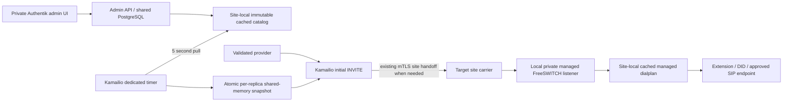

# AVoIP administration and managed routing

Implementation source is in this repository. Runtime activation is separate:
`avoipAdmin.enabled` creates administration resources on telephony sites;
`avoipAdmin.routing.enabled` independently opts into managed SIP routing. Existing
When managed SIP routing is enabled, inbound DIDs must exist in the Admin
catalog. Missing or expired snapshots and unknown DIDs fail closed.
Do not enable routing merely to obtain the management interface.

The owner is the existing
[AVoIP ApplicationSet](https://slop.writemy.codes/CoRE/CoRE-Backplane/src/branch/main/Apps/Business/AVoIP.yaml).
It supplies named carrier/private/WebSocket instances and site values. Both
`core-home1-talos-prod` (YVR/Home1) and `core-dc1-talos-prod` (YXL/DC1) run
FreeSWITCH. See [the current architecture](avoip/architecture.md),
[inter-site voice](INTERSITE-VOICE.md), [outbound policy](OUTBOUND-PILOT.md)
and [phone tree](PHONE-TREE.md) for the existing trust and call paths.

## Private site-local management

The default hostname is
`avoip-admin.<cluster>.<datacenter>.<region>.resolvemy.host`, configurable through
`avoipAdmin.hostname`. The private Gateway HTTPRoute uses the existing Authentik
outpost and grants access only to `flowrouteSMS.inbox.adminGroup`, normally
`AVoIP Admins`. It has no Forecastle annotations or public ExternalDNS label.
Optional `avoipAdmin.dns.enabled` publishes a DNS-only CNAME to the existing
site HTTPS gateway name specified by `avoipAdmin.dns.target`. The public DNS
metadata makes the hostname discoverable; it does not bypass Authentik. This
uses the existing ExternalDNS CRD source and its `wan-mode=public` selector on
a separate DNSEndpoint, never on the private HTTPRoute. DNSEndpoint has no BJW-S
resource class, so its custom API template is explicit. See
[ExternalDNS CRD source](https://github.com/kubernetes-sigs/external-dns/blob/master/docs/contributing/crd-source.md).
The API independently requires authenticated username and exact group membership.
Group headers are JSON generated by an Authentik property mapping and forwarded
through external authorization; refresh the Authentik session after changing
mappings or membership. The UI follows [the shared Material design spec](UI-DESIGN.md).

The UI/API on port 8080 is reachable through the authorized Gateway. Internal
routing uses a separate port 8081, site-local generated token and endpoint-specific
mux. NetworkPolicy admits that port only from local Kamailio and FreeSWITCH
workloads. The UI listener does not register machine routing endpoints. No pod
service-account token or write access to Kubernetes is needed.

All sites use the existing primary-region CoRE-Voice application's PostgreSQL
identity. The primary publishes its stable connection reference to Vault through
PushSecret; each site imports it with ExternalSecret. `avoipAdmin.primaryRegion`
and `databaseRemoteKey` select this publication, defaulting to YVR and
`AVoIP/Admin/Database`. Only the primary publishes. Do not resolve or print URI
contents. Database lifecycle remains with the platform
[User Composition](https://slop.writemy.codes/CoRE/CoRE-Backplane/src/branch/main/Operations/SSO/User/templates/User/UserComposition.yaml)
and [PostgreSQL owner](https://slop.writemy.codes/CoRE/CoRE-Backplane/src/branch/main/Apps/Storage/PSQL.yaml).
A separate generated site token authenticates routing; database passwords are
not handed to Kamailio. Vault, ESO generators, the existing User/XUser and
PostgreSQL grants must be ready before admin pods can become ready.

## Configuration ownership

| Setting/API | Behavior |
| --- | --- |
| `flowrouteSMS.providers` | Optional Git-managed SMS account definitions; authoritative for matching provider IDs and read only in UI |
| `flowrouteSMS.providerCredentials` | Map `SMS_PROVIDER_*` environment names to existing Secret `name`/`key` references; inject into API, webhook and administration where needed |
| `flowrouteSMS.localNumbers` | Explicit legacy Flowroute number inventory; admins also see historical local senders/recipients and other configured provider numbers |
| `avoipAdmin.catalog: null` | Administrators manage the shared SIP catalog in PostgreSQL |
| `avoipAdmin.catalog: {providers, dids, extensions, limit_profiles, ivrs, version}` | Entire catalog is Git-managed and read only in UI; configure consistently across sites |
| `avoipAdmin.upstreams` | Provision additional FreeSWITCH gateways with Vault-backed credentials or `authentication: 'ip-acl'`; registration is explicitly enabled per gateway |
| `avoipAdmin.sites` | Optional site-target overrides; normally derived from local FreeSWITCH and existing authenticated inter-site carrier peers |
| `avoipAdmin.routing.upstreamCIDRs` | Explicit network egress approval for additional carrier TLS destinations; an admin catalog edit cannot widen Kubernetes network policy |
| `GET/PUT /api/sip` | Read/replace catalog, admin-only with version conflict detection |
| `GET /api/ivr/media` | Admin-authenticated proxy to the site's shared audio-library WAV index; does not disclose the internal service address |
| `POST /api/routing/preview` | Admin-only outbound policy preview using the current extension, destination, caller ID, site and provider catalog |
| `POST /api/routing/inbound-preview` | Admin-only inbound DID preview using the current DID, provider assignment, optional source IP, site and catalog revision |
| `GET /api/audit` | Recent protected control-plane audit metadata; no credential values |
| Telephony tab | Shows live AMI/Event Socket status, every resolved Asterisk/FreeSWITCH/Kamailio control replica, active SIP registrations and Contacts from the configured registrar databases, active Asterisk and FreeSWITCH calls, and recent Asterisk/FreeSWITCH CDR rows when `avoipAdmin.telephony.enabled` is configured; the topology view groups replicas by logical service and opens a read-only per-replica inspector; `End call` and FreeSWITCH debug controls send audited, same-origin admin requests |
| `GET /routing/snapshot` | Token-authenticated internal compiled route view; machine listener only |
| `POST /routing/freeswitch` | Authenticated internal XML dialplan for managed contexts; machine listener only |

SMS provider APIs and webhook configuration are described in
[SMS messaging](FLOWROUTE-SMS.md). SIP and SMS provider accounts are distinct;
a shared product name does not make SIP credentials valid for the SMS API.

The telephony viewer is opt-in and disabled by default. Configure dedicated
read-only PostgreSQL connection Secrets for each CDR table if CDR viewing is
needed; leaving those references empty enables management connections without
granting CDR access. The Admin's own catalog database identity is not a CDR
reader. The AMI and FreeSWITCH Event
Socket adapters use the retained generated `avoipAdmin.telephony.managementSecret`.
The chart publishes that password to Vault, writes the Asterisk AMI user file
at container startup, and binds both management interfaces only to private
ClusterIP Services. NetworkPolicy permits the Admin workload to reach those
ports; do not expose AMI/Event Socket through a Gateway or public Service. The
CDR query is read-only and returns at most 50
recent records per database. Active call termination requires the Admin group;
each accepted request is written to the existing Admin audit table.

When the Kamailio registrar is enabled, the chart also injects the existing
registrar connection Secrets as read-only Admin environment references. The
Telephony tab queries each `public.location` table without mutating it and
filters expired rows in the Admin process. It displays the AoR, Contact,
received address, Path/flow metadata, connection and server identifiers,
user-agent, expiry, and registrar/site name. It never displays the connection
URI, password, Digest verifier, or other Secret value. A registrar database
that cannot be reached is shown as unavailable while other registrar and
replica results remain visible. The Telephony page presents those results as
service cards and responsive replica tiles rather than a single dense table.
Kamailio controls retain the configured instance name and role, so carrier,
internal, WebSocket registrar, and other enabled Kamailio roles render as
separate service groups instead of one anonymous control pool.
Selecting a tile opens an accessible read-only inspector with overview,
verified active-call data, shared registrar connections, and explicit empty
states for configuration and diagnostics that are not currently provided by
the backend. It does not infer SIP flow ownership from a shared database row
or expose arbitrary shell/Kubernetes control.

A SIP provider has ID/name, canonical SIP hostname, an optional digits-only
egress prefix, explicit signaling CIDRs, per-site provisioned gateway names and
reviewed caller-ID records. Each
verification record includes a canonical E.164 number, independent evidence and
optional absolute expiry. Overlapping signaling networks across providers are
rejected because the source would be ambiguous. Number ownership evidence is
an admin-reviewed entitlement, not STIR/SHAKEN authentication of an inbound caller.

Provider selection, site gateway mapping, extension authorization, caller-ID
selection, and egress limits are managed in the shared AVoIP Admin SIP catalog.
The FreeSWITCH-to-Kamailio transport target is deployment infrastructure: the
chart defaults its separate `freeswitch.flowrouteOutbound.kamailioInstance`
setting to `internal-ha`, and YVR provisions that three-replica private SBC
with the carrier gateway, mTLS client identity, and authenticated FreeSWITCH
peer route required for carrier egress. The selected instance must have
`carrierOutbound.enabled` and `carrierOutbound.clientIdentity.enabled`; Helm
validation fails otherwise. The selected HA instance alone loads the Admin
routing snapshot client and receives the matching API egress allowance; the
other WebSocket registrar replicas do not gain carrier routing policy. Sites
without the HA role select and provision their existing private SBC explicitly.
TLS identities, peer allowlists, and Kubernetes Services remain
deployment-managed so Admin catalog changes cannot alter transport trust or
network policy. The WebSocket registrar remains a distinct ingress service.

Provider **Supported codecs** declares the upstream capability set, and
**Codec order** sets its preferred order. The FreeSWITCH XML dialplan applies
that order to the outbound gateway leg with the documented
`export nolocal:absolute_codec_string=...` action before bridging; a DID codec
order overrides the provider order when configured. If the order is empty, the
supported list order is used. Legacy Twilio Elastic SIP records with no codec
fields use the documented PCMU, then PCMA baseline because those are Twilio's
generally available termination codecs ([Twilio codec support](https://www.twilio.com/docs/sip-trunking/codecs),
[FreeSWITCH codec negotiation](https://developer.signalwire.com/freeswitch/media-and-codecs/codecs/)).
An explicit Admin provider or DID order always takes precedence. The selected
provider, site, and effective codec order are also written to the FreeSWITCH
call log for correlation with Kamailio's Homer events.

A DID lists its allowed inbound providers, each with current number-ownership
verification, and a destination site plus one of:

- `ivr`: an AVoIP Admin-managed IVR. Enter its stable ID; an empty legacy value
  resolves to the site's `main` IVR when present, or the only site IVR;
- `extension`: an explicit numeric internal extension;
- `did`: canonical external number, outbound provider and a verified caller ID;
- `sip`: an explicit `sips:user@host[:port]` endpoint without arbitrary headers,
  URI parameters or dialplan expressions.

Each DID also has **Detect fax after answer**. It is enabled for existing
records that lack the field, preserving their post-answer fax detection.
Disable it on a DID to skip SpanDSP detection. The site-wide
`freeswitch.fax.enabled` and `freeswitch.fax.autoDetect` settings must also be
enabled for detection to run. Detected faxes transfer to the existing
`fax-receive` processing path; the DID destination still controls the voice call.

An extension can select verified caller IDs and authorized providers in
preference order. A caller ID is eligible only through a provider that has
current verification evidence and a gateway at the selected site. The first
caller ID is the runtime default; for that identity, the first currently
eligible provider is used. Route preview can check another authorized caller ID
and shows each provider removed by verification or missing site gateway. The
**Extensions** screen also stores assignment metadata, display name and
explicit enabled/outbound-enabled/voicemail-enabled flags. Entries without
enablement flags retain
their prior enabled behavior. Disabled entries stay identifiable in the
immutable routing snapshot, but Kamailio rejects their outbound calls with a
distinct reason (`extension_disabled` or `outbound_disabled`) in Homer. This screen governs
authorization; it does not rewrite Asterisk endpoint credentials or report
live registration state. Registration attempts and responses are correlated
in Homer using the SIP Call-ID. The preview's `failover_order` is the remaining
eligible provider candidate order; FreeSWITCH currently uses the first eligible
provider and does not retry another provider. Live health-based failover is not
implemented, and the preview reports provider health as `not_reported`.

The **SIP users** tab manages non-secret SIP identity assignments in the same
versioned PostgreSQL catalog: numeric SIP username, configured extension,
display name and registration-enabled flag. The site's assignment and
Authentik user metadata are inherited from the linked extension, avoiding a
second owner mapping. A user must reference an existing extension; registration
cannot be enabled for a disabled extension. Admin never accepts or stores SIP
passwords or Digest verifiers. Keep those credentials in the platform secret
store. These records are management metadata only: they are not yet projected
into Kamailio's dedicated registrar database and do not switch the live
Asterisk registration path.

Each DID card can preview an inbound route without placing a call. The preview
checks the exact DID, site, assigned provider and optional provider source IP
against the current catalog, then displays the destination and policy revision.
Provider health and failover targets are not represented by the current
catalog, so the preview reports provider health as `not_reported`.

The editor accepts an optional assigned Authentik user ID/username as Admin metadata. It does not change SIP authentication or extension identity. Voice destinations, DIDs and caller IDs must already use the full `+1` plus ten digit representation. That value is preserved through Asterisk, internal Kamailio and FreeSWITCH. When the selected provider defines an egress prefix, carrier Kamailio changes only the final upstream Request-URI to `prefix*1AAAAAAAAAA`. Per-extension destination allow/block lists are not part of the routing catalog.

Each extension card also has a **Preview route** action. It checks the current extension, site, exact caller ID, full-format destination and provider verification, then returns the policy revision, selected provider and effective codec order. Provider health is reported as `not_reported`: the catalog does not yet contain live health or failover state.

### Call Limit Profiles

The **Limit Profiles** screen stores named profiles in the existing shared SIP
catalog. Each profile sets calls per minute, concurrent calls, and maximum call
duration. A profile can be assigned directly to an inbound DID or extension,
or made the default for one site or tenant. On each call, an explicit record
assignment wins; otherwise the matching tenant profile wins, followed by the
record's destination/egress site profile. When none is configured, the existing
site values under `kamailio.defaults.carrierOutbound.limits` remain the compatibility
default; outbound calls retain their legacy caller-ID quota bucket in that
case.

The assigned profile ID is the quota bucket, so records using the same profile
share its rate and concurrency ceiling within the local telephony site's
Dragonfly database. Site and tenant profiles use that same rule. The catalog is
shared between YVR and YXL, but the call-limit counters are site-local; a
tenant profile applied at both sites currently enforces the configured ceiling
independently at each site, not as one cross-site aggregate. Cross-site aggregate
limits require a globally shared atomic quota service. Call duration is applied
to the Kamailio dialog timer and expired dialogs are terminated; failed or
cancelled calls release their reservation, while abandoned reservations expire
after the configured maximum duration. Changes publish through the normal
five-second routing snapshot refresh and affect new calls; established calls
keep their applied duration.

Assignments are evaluated only from the existing authenticated
Asterisk/private-SBC path. From/PAI supplied by an untrusted endpoint is never
authorization to select a caller ID. Destinations must use the full `+1` plus ten digit format. The runtime does not apply destination allow/block lists or premium-rate number filters. Extension/provider authorization, caller ID verification and carrier quota remain in force.
On the second Kamailio hop, the site-private peer is accepted only over its
authenticated TLS identity. That hop revalidates the stamped extension against
the current Admin snapshot and applies the authorized caller ID; it does not
reject the call because an intermediate SIP From value changed.

### Configure the current inbound numbers in Admin

In **SIP providers**, keep the inbound carrier's signaling CIDRs, site gateway,
and a current ownership verification record for each DID. In **DIDs**, add one
record per inbound number, using canonical `+1…` format and the provider ID in
**Allowed inbound provider IDs**:

| Number | Destination site | Destination type | Destination |
| --- | --- | --- | --- |
| Voice DID | `yvr` | `extension` | `67` |
| Other DID | `yvr` | `extension` | `66` |

To send a DID to a catalog-managed IVR, change its destination type to `ivr`
and enter the matching IVR ID (for example, `main-menu`). The IVR tab selects a
greeting from the site's shared audio library and defines digit routes as
structured destination types; DID routes must use the existing authorized
provider and verified caller ID. IVR catalog edits are validated and saved
through the versioned `/api/sip` API, then consumed by FreeSWITCH's authenticated
XML-curl lookup. See
[managed IVR status and migration](IVR-ADMIN-MANAGED.md). An extension
destination must exist in Asterisk SIP Core. Add or verify the **Caller ID
assignments** record for `7101` separately: select its outbound provider,
verified caller-ID number,
and egress site. An inbound DID route does not grant outbound caller-ID use.
The catalog is shared across sites; confirm both sites have fresh routing
snapshots before changing a destination.

Additional upstream gateways use the established FreeSWITCH carrier profile and
private-to-carrier Kamailio proxy, preserving the public signaling border and
RTPEngine anchoring. A credential-backed gateway reads username and password
from Vault. An `ip-acl` gateway is a ConfigMap with no SIP credentials and must
use `register: false`; the carrier must authorize the site's actual public
egress IP. The [FreeSWITCH non-registering gateway guidance](https://developer.signalwire.com/freeswitch/users-and-endpoints/gateways/)
documents this mode. Provision carrier authentication and network reachability
first, then map the gateway name in the catalog. Gateway host and catalog host
must agree. Adding or rotating credentials requires a controlled FreeSWITCH
reload/rescan or rollout; metadata editing does not independently register a new
carrier account. Keep existing Flowroute gateway names reserved.

YVR provisions `twilio-west` as an IP ACL gateway to the
[Twilio Oregon termination URI](https://www.twilio.com/docs/sip-trunking), with
no registration. The site policy permits outbound TLS signaling to Twilio's
[Oregon signaling range](https://www.twilio.com/docs/sip-trunking/ip-addresses)
on port 5061. In Admin, the `twilio-west` provider must use
`coreinc-yvr.pstn.umatilla.twilio.com` as its host and `twilio-west` as its
YVR gateway. Assigning an extension to this provider selects Twilio only for
that extension; the gateway's presence does not change existing assignments.
Twilio must allow the observed YVR public source IP in the trunk's IP Access
Control List and accept the chosen verified caller ID.

## Pull, enforcement and failure behavior

The admin process refreshes its catalog every two seconds; its machine endpoints
read in-memory state. Kamailio's dedicated timer pulls every five seconds with
a one-second HTTP bound. SIP workers read a single pinned JSON snapshot in
shared memory and make no HTTP/PostgreSQL call. Snapshot validity is bounded by
60 seconds since the last successful database refresh and by the earliest
verification expiry. Managed new calls fail closed when their snapshot is stale;
existing unmanaged routes continue under their prior policy. This is a separate
routing entitlement layer from the proposed
[Caller Intelligence classifier](caller-intelligence/README.md).

Cross-site dispatch uses the existing carrier mTLS, source CIDR and SAN checks,
not direct remote FreeSWITCH access. The receiving site independently checks its
local snapshot and target site. Private FreeSWITCH managed ingress is TCP/5072,
restricted to local named Kamailio workloads, then passes through controlled
managed XML contexts. In-dialog/CANCEL paths remain on their existing transaction/
TOPOS route; snapshot changes do not reroute established dialogs. TM state is
still local to each Kamailio replica: ingress affinity remains required.

The generated managed profile, init-container XML config and `mod_xml_curl`
loading are conditional on routing activation. All other FreeSWITCH contexts
continue using existing XML dialplans. `mod_xml_curl` can add a bounded lookup
before XML fallback; validate its exact behavior and outage latency in the
pinned deployed image before activation. Missing managed mappings return XML
not-found rather than inventing a destination. TLS, media, topology, fax,
voicemail, IVR, registrations and teardown require end-to-end regression evidence.

### Private FreeSWITCH-to-Asterisk voicemail TLS

When SIP Core is enabled, Asterisk's TLS listener uses the image's public CA
bundle plus `ca.crt` from the TLS Secret of the selected
`asterisk.sipCore.kamailioInstance`. The private CA Secret is mounted read-only;
its rotation triggers an Asterisk rollout so the PJSIP transport reloads the
new trust chain. TLS verification remains enabled for any Asterisk-originated
TLS connection. Do not work around a trust failure by disabling verification.
A TLS transport CA change requires a complete Asterisk restart in Asterisk 20,
so validate the rendered config and certificate chain before rollout. The
current YVR call path uses Asterisk only as a voicemail server; FreeSWITCH
initiates this private SIP connection. See the official
[Asterisk 20 PJSIP transport documentation](https://docs.asterisk.org/Asterisk_20_Documentation/API_Documentation/Module_Configuration/res_pjsip/).

## Rollout, verification and rollback

1. Build/test/pin API, web, webhook, admin and managed-routing images. Use BJW-S
   common for workloads/services and inspect the complete Lovely Helm/Kustomize
   render with both site-injected layers.
2. Reconcile the SMS webhook replicas first and confirm every replica uses the
   new image before exposing deletion through the API/inbox. Older receivers do
   not honor deletion tombstones. Then roll API and web, preserving callback
   reachability and testing signed fixtures before an authorized real message.
   Activate administration alone. Verify primary User/XUser, PushSecret, imported
   connection, generated local machine token, both admin replicas, exact-group
   access, private DNS/Gateway attachment and admin/non-admin API behavior.
3. Configure provider metadata, gateway credentials, network egress, DID ownership
   evidence and extension associations. Confirm both site views agree; simulate
   source and target matches using synthetic reserved numbers.
4. Enable managed routing only in a controlled call window with no unintended
   active-call interruption. Verify module availability including FreeSWITCH
   `mod_xml_curl`, local cache freshness, all three carrier replicas, site handoff,
   unauthorized provider/CLI rejection, allowed calls, BYE/ACK/CANCEL and original
   IVR/fax/voicemail paths. A ready pod or Argo `Synced` is insufficient.
5. Disable managed routing to roll back to the original paths; retain catalog,
   verification/audit and SMS data. Do not drop tables, delete User claims or
   remove provider accounts as routing rollback. Inspect orphan and Secret/PVC
   retention separately during retirement.

Schema startup uses an advisory migration lock and additive tables/columns;
older code remains compatible. SIP catalog and provider updates are versioned; all administrative mutations are
audited. Deleting an SMS message removes its stored attachments and retains a
minimal tombstone to prevent callback replay from restoring it; it does not
recall delivery or erase provider copies/backups. No default cleanup retention
is imposed by this change.

## Validation record and activation boundary

The implementation was checked with Go race tests and a disposable localhost
PostgreSQL database, including additive DDL, concurrent message deduplication,
tombstones, authorization and optimistic updates. Provider HTTP requests and
webhook signatures use synthetic fixtures; no paid provider calls are required.
The database integration tests require `SMS_TEST_DATABASE_URL` pointing to a
throwaway localhost database ending in `_test` and reset their own test tables.
Never point these tests at an application database.

With managed routing disabled, all 68 existing YVR SIP/media resources compare
exactly against the pre-change baseline, including configuration strings and
FreeSWITCH credential templates. This avoids incidental configuration reloads.
Both YVR and YXL Backplane value layers were rendered through Helm and the local
Kustomize patches. Embedded XML, Terraform/HCL and Authentik Python expressions
were parsed. Native Kamailio syntax checks cover carrier/private configurations
at both sites; the existing WebSocket LF-heartbeat image remains separate.
See [the UI fixtures](UI-DESIGN.md#reproducible-browser-fixtures) for browser
coverage and remaining accessibility acceptance.

Image publication is tracked in the [SMS build](https://slop.writemy.codes/CoRE/CoRE-Business/actions/runs/54)
and [managed Kamailio build](https://slop.writemy.codes/CoRE/CoRE-Business/actions/runs/51).
Chart defaults leave administration and managed routing disabled. The owning
Backplane ApplicationSet explicitly enables administration on YVR and YXL,
keeps SMS in YVR, and leaves managed SIP routing disabled. The original design
publication did not reconcile Argo CD or change production schema/routing;
administration deployment now follows the staged rollout above. Real carrier calls, cross-site handoff,
`mod_xml_curl` availability in the deployed FreeSWITCH image, production
Authentik login and original fax/voicemail paths remain activation checks.

### Authentik outpost registration

Admin Workspaces use an application-scoped Terraform ProviderConfig, pinned to
[Authentik provider 2026.8.0](https://registry.terraform.io/providers/goauthentik/authentik/2026.8.0/docs).
It reuses the existing Authentik controller credential Secret reference and
uses an [outpost provider attachment](https://registry.terraform.io/providers/goauthentik/authentik/2026.8.0/docs/resources/outpost_provider_attachment)
to register only this app with `AAA-MainProxy`. It does not take ownership of
the outpost or replace its other providers. The global `authentik` ProviderConfig
and existing application provider versions stay unchanged. `avoipAdmin.auth`
configures the version, API URL, outpost name and stable credential references.
ProviderConfig is a Crossplane custom API without a BJW-S resource class.

The admin-only Terraform ProviderConfig retains the existing Authentik Kubernetes
state backend (`providerconfig-authentik` in the credential namespace). Workspace
state remains scoped by workspace identity; changing the plugin version must not
move or reset that state. No state migration or application recreation is intended.
The admin Workspace initializes with `-reconfigure -upgrade` so cached Terraform metadata
uses this unchanged backend after the provider split; it does not migrate state.

Deployment verification: [SMS image build 57](https://slop.writemy.codes/CoRE/CoRE-Business/actions/runs/57)
completed successfully for source `c5257a676f01a38340791bb752ef95575eee7aaa`.
The chart pins all four images by digest. Explicit Envoy identity-header forwarding
restored inbox number visibility, confirmed by the signed-in user. Managed SIP
routing remains disabled in the owning ApplicationSet during this deployment.
The upgrade flag refreshes the cached dependency lock to the exact admin provider
version pinned in values; it does not relax the version constraint or upgrade the
global Authentik ProviderConfig.

### Initial rollout status

The YVR rollout of commit `8f4beeed4f7f1d2e32835734bc0b3a016b8138e5`
completed through a resource-selected Argo sync. The webhook receivers were
updated first; the inbox API, web frontend and admin service followed. All four
Deployments have two updated, available replicas. The SMS and admin Authentik
Workspaces report both Ready and Synced. Anonymous requests, including requests
carrying forged identity headers, redirect to Authentik for `/inbox`,
`/api/numbers`, and the admin page/API. The signed-in user confirmed that their
numbers appeared after explicit identity-header forwarding was deployed.

The YVR management URL is
<https://avoip-admin.core-home1-talos-prod.home1.yvr.resolvemy.host/>.
The inbox remains <https://sms.resolvemy.host/inbox>.

YXL has two available admin replicas, but its earlier authentication sync is
still waiting for the Workspace to become healthy. Its DNS and proxy attachment
have not been verified complete. Finish that scoped reconciliation with the
same reviewed commit after the active operation ends or an authorized termination;
do not claim the YXL management URL is ready based on pod readiness alone.

The owning ApplicationSet keeps managed SIP routing disabled. No SIP/media
resources were selected in these rollout operations, and verification did not
send paid SMS or delete stored messages. Enabling managed voice routing still
requires the controlled call, fax, voicemail, failover and rollback checks above.
