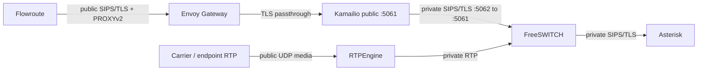

# AVoIP SIP boundary and availability architecture

The optional [administration and routing layer](../ADMIN.md) adds a site-local
control plane and native Kamailio snapshot pulls. Its managed FreeSWITCH profile
is separately activated; existing SIP paths remain the baseline.

The documentation-only [Caller Intelligence extension](../caller-intelligence/README.md)
proposes a standalone Go policy service and bounded initial-INVITE evaluation.
See its [discovery baseline](../caller-intelligence/discovery.md) for current
Backplane carrier replica declarations; it does not change this SIP boundary.

## Current boundary

Kamailio is the only public SIP boundary. FreeSWITCH and Asterisk are internal
application peers. The public Kamailio Service is currently a mixed Service
with 5061 and 5062; the planned split into `kamailio-public` and
`kamailio-private` waits for the active ACK investigation to close.

The public identity is the site SIP hostname (or `sip.resolvemy.host` when the
opt-in global route is enabled). FreeSWITCH uses only Kamailio's private
ClusterIP identity. RTPEngine owns media anchoring and its public UDP address;
Kubernetes Service load balancing is not treated as safe established-call
media ownership.

The chart's next site-local border target is three Kamailio replicas. The
replicas share TOPOS records through the site-local Dragonfly allocation, use
hostname anti-affinity and spread constraints, and are protected by a
`minAvailable: 2` PodDisruptionBudget. This improves new-call admission during
one pod or node failure, but does not migrate an in-flight TCP/TLS connection,
Kamailio transaction, FreeSWITCH channel, or RTPEngine UDP session.

The pinned common-library version does not render `minReadySeconds`, so the
Lovely Kustomize layer applies a 60-second minimum-ready interval to Kamailio,
FreeSWITCH, and RTPEngine Deployments (and the Kamailio StatefulSet when
enabled). During a rolling update, Kubernetes waits until a replacement has
remained Ready for that interval before advancing to the next replica (see
the [Deployment rolling-update behavior](https://kubernetes.io/docs/concepts/workloads/controllers/deployment/#min-ready-seconds)).
RTPEngine uses required Redis persistence and restores saved sessions during
startup. Its entrypoint gates readiness on the restore-completion message
(`Redis restore time = … ms`), and the Deployment then requires the replacement
to remain Ready for 60 seconds. With `maxUnavailable: 0`, Kubernetes retains
the previous pod until both conditions are met. If Redis restoration does not
complete, the rollout stalls with the previous pod still running. This is a
startup rollout safeguard, not proof that a surviving RTPEngine pod can take
over an existing media socket or that media survives a node failure.

## HA progression

The safe order is shared topology state, site-local Kamailio/Envoy replicas,
deterministic FreeSWITCH dialog affinity, tested RTPEngine recovery, and only
then multi-site routing or anycast. Existing dialogs remain site-pinned until
their SIP, B2BUA, and media state can be recovered elsewhere.

See [SIP border](sip-border.md), [topology hiding](topology-hiding.md),
[RTPEngine HA](rtpengine-ha.md), and [failure domains](failure-domains.md).
For node-level TCP debugging during a border incident, use the documented
[Inspektor Gadget procedure](runbooks/sip-border-failure.md#inspektor-gadget-network-debugging).
For CNI policy, drop, and endpoint-path evidence, use the same runbook’s
[Cilium pod tracing procedure](runbooks/sip-border-failure.md#cilium-pod-level-network-tracing).
TLS-boundary and narrowly scoped SIP payload capture options are documented in
the runbook’s [TLS and SIP inspection section](runbooks/sip-border-failure.md#tls-and-sip-payload-inspection).
