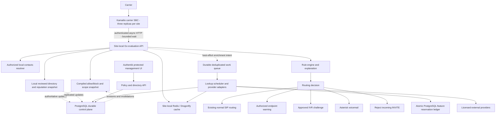

# Service architecture and execution contract

Everything below is proposed. [Discovery](discovery.md) describes current state.
The Go service has independently scalable evaluator and worker modes sharing
versioned contracts. A management backend/UI uses the same domain model.
The evaluator has **no Internet/provider call capability**.

## Boundaries

| Component | Responsibility and authority |
| --- | --- |
| Evaluation API | Accept authenticated SBC facts, resolve authorized DID/tenant scope, return deterministic bounded local decision |
| Number normalization | Parse SIP/tel user safely, normalize E.164 with pinned metadata; preserve withheld/malformed/unknown states |
| Contact directory resolver | Tenant/user-scoped local snapshot from a future approved directory source; private contacts never become global identities |
| Policy engine | Compile immutable policy revisions; explicit precedence and simulation; return matched/shadowed rules |
| Reputation engine | Decayed, deduplicated signals from reviewed reports and asynchronous call outcomes, distinct from identity confidence |
| Business identity resolver | Reviewed UUID entities/branches, aliases, time-bounded number associations and evidence; candidate matches stay unverified |
| Provider adapters | Capability and license manifests, explicit feature requests, normalized results, bounded outbound traffic |
| PostgreSQL | Authoritative policy, reviewed records, permitted provider evidence, jobs, audit, usage reservations and reconciliation |
| Redis/Dragonfly | Disposable shared low-latency cache and single-flight hints; not the sole policy or quota authority |
| Management API/UI | Authentik user authorization, simulation, review, changes and spending visibility |
| Telemetry/audit | Local nonblocking decision event queue, metrics and traces; durable change audit transaction with control-plane writes |

[Go](https://go.dev/) [documentation](https://go.dev/doc/) supplies bounded
contexts and HTTP servers. Select supported Go and library versions during
implementation. Reuse existing pgx engineering conventions, not SMS ownership
or database tables. Workers can be paused independently of call evaluation.

## Initial inbound call execution

1. Kamailio validates ingress source and local DID before admitting evaluation.
   Its existing in-dialog, CANCEL, ACK and retransmission paths run first.
2. Kamailio creates/checks the INVITE transaction, generates a correlation ID,
   and submits the selected identity and provenance to the internal API.
   The service resolves scope from the authorized SBC/site and DID inventory.
3. Evaluator reads its immutable local policy/contact/directory snapshot and
   optionally site Redis under a strict subdeadline. No remote PostgreSQL
   primary, worker queue or Internet dependency is required for a call.
4. Evaluate explicit rules and weighted evidence, then return versioned decision,
   explanation, freshness, confidence and stale/degraded flags. Enrichment is
   best effort: losing an intent loses enrichment, not the call. A local spool
   with bounded size can later drain to the durable job table.
5. SBC validates the response and maps an enum to preconfigured local targets.
   It never accepts an arbitrary routing URI. Late responses cannot reroute a
   ringing or established call. Enrichment affects later calls or a management
   view only. A later extension selection is a separate scoped local gate only
   if explicitly implemented; it never repeats paid evaluation.

Only an initial inbound carrier INVITE without a To-tag starts full evaluation.
Deduplicate SIP transactions separately from normalized-number enrichment.
A different CSeq transaction must not inherit a prior call's action solely
because the caller number matches. See [integration](kamailio-integration.md).

## Proposed latency objectives, not measurements

| Stage | Starting target |
| --- | --- |
| In-process policy + metadata evaluation | p95 <= 5 ms |
| Site Redis attempt | <= 5 ms subdeadline; circuit break rather than repeated retries |
| Evaluation API including local network | p95 <= 20 ms; p99 <= 50 ms at validated load |
| Evaluator hard deadline | 50 ms, including serialization; no per-call durable write requirement |
| Kamailio total HTTP wait | 75 ms starting proposal, below configured `tm` timers; validate network/timer behavior |
| Provider worker request | 2 s Twilio/Sinch; 3 s Places; never included in the above budgets |

No nested retry may exceed the overall deadline. Bound request sizes, CPU,
queue depth, concurrency and Redis connections. Benchmark against a declared
call rate and burst profile before treating the targets as achieved.

## Failure behavior

| Failure | Call behavior | Background/control-plane behavior |
| --- | --- | --- |
| Provider error, timeout, quota exhausted or Canadian approval absent | Local/cached evaluation continues | Suppress feature, short error cache, alert; never automatic overage |
| Redis unavailable | Use compiled in-process policy and permitted local snapshot; no duplicate paid scheduling | Stop cache-dependent work; PostgreSQL unique job/ledger remains authority |
| PostgreSQL unavailable | Existing site snapshot continues within its accepted age | Reject policy writes and new paid reservations; bounded event spool, visible lag |
| Service timeout, invalid response, TLS/auth failure or no usable snapshot | Normal pre-existing routing with `degraded` telemetry | Alert; no synthetic spam score or SIP 503 for a classifier failure |
| Stale identity/reputation | Use only within license and stale allowance; otherwise unknown | Queue refresh subject to budget |
| Stale policy snapshot | Use signed last-known-good snapshot up to proposed 24 h, honoring absolute rule expiry; then bypass optional protection | Mark degraded and alarm; policy writes acknowledge active-site convergence separately |
| Telemetry unavailable | Continue routing; never block on log export | Bounded drop counters; management changes fail if transactional audit cannot be written |

This availability-first fallback can temporarily admit a blocked caller during
a severe outage. It is deliberate and visible. A future fail-closed DID mode
requires separate approval and emergency/fax analysis; it is not this default.
A valid explicit block in a fresh local snapshot remains effective when a
provider fails. A paid lookup failure must not negate an allow or block rule.

## Decision lifetime

Pin one policy revision and evidence snapshot per evaluation. Return an absolute
`decision_expires_at`, bounded by the earliest relevant rule expiry, policy
snapshot age, source hard expiry and a proposed 30-second decision cache cap.
A policy revision change invalidates reusable decisions, not active dialogs.
Store a small immutable transaction result for retransmission consistency;
that result is not a general number cache and does not reopen routing.
