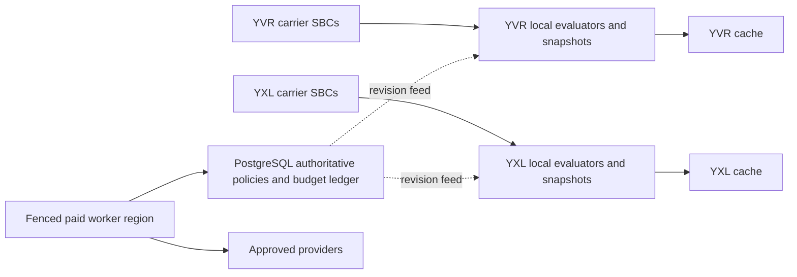

# Proposed deployment and multi-site architecture

No manifests, resources or namespace changes accompany this design. The
[AVoIP ApplicationSet](https://slop.writemy.codes/CoRE/CoRE-Backplane/src/branch/main/Apps/Business/AVoIP.yaml)
currently owns this rendering unit. A future implementation can add disabled
Caller Intelligence values within `AVoIP`, retaining fleet ownership in
Backplane; splitting into a separate Application requires an explicit ownership
ADR, not an invented current path or migration to the README-only repository.

## Proposed resources and value layers

Use [BJW-S common library](https://bjw-s-labs.github.io/helm-charts/docs/common-library/)
where pinned version 5.0.1 supports controllers, services, persistence and routes.
Verify its supported fields first. Use direct templates only for unsupported
platform/identity/custom APIs and document exceptions. Runtime names below are
logical proposals, not committed Kubernetes names.

| Proposed resource | Placement and lifecycle |
| --- | --- |
| Evaluator Deployment + private Service | At least two replicas per telephony site, spread across hosts, bounded graceful drain and PDB; separate from SIP pods, no SIP/RTP ports |
| Management API/BFF/UI | Private Authentik-protected HTTPRoute; preferably separate listeners/process limits from evaluator; no public dashboard exposure |
| Lookup worker | Single designated budget writer region initially, fenced dispatch ownership; scales independently, disabled without approved provider configuration |
| Policy snapshot distributor | Durable revision/outbox consumer with authenticated site feed, signed checksum/epoch and per-site acknowledgements |
| Local snapshot storage | Minimal encrypted retained last-known-good policy/directory snapshot; temporary spool bounded by bytes/age, backup/retention reviewed |
| Namespaced platform User claim | Stable application identity and PostgreSQL connection Secret; one coherent identity lifecycle, no unrelated DB password |
| ExternalSecrets/certificates | Vault-backed provider references, mTLS server/client identities; no credential literals in values or manifests |
| NetworkPolicy/Cilium policy | SBC -> evaluator only; UI/BFF -> management; evaluator -> local cache/feed; worker -> approved provider HTTPS + ledger; deny public provider access from evaluator/SBC |
| Metrics and telemetry integration | Site collector discovery/OTLP according to installed platform; bounded nonblocking queues |

Required configuration layers: chart defaults (disabled), explicit site enablement
and roles, cluster name/domain/environment, authoritative DID/extension ownership,
Gateway/listener/private hostname, SecretStore references, User/database provider
references, new cache allocation, provider capability/tariff/license revisions,
policy snapshot trust keys and active revision, telemetry endpoints, feature flags
and action mappings. Distinguish evaluator enablement, observe mode, enforcement
and paid-worker enablement. Enabling one must not enable the others.

Render the complete Lovely unit including [local Kustomize](../../kustomization.yaml)
with Backplane-injected values and existing rollout patches. Standalone Helm
output is a partial check. Review the actual plugin configuration and pinned
image before using features; do not execute arbitrary scripts or fetch mutable
remote inputs. There are no new remote resources in this documentation package.

## Platform data and identity dependencies

- Reuse shared PostgreSQL through its [fleet owner](https://slop.writemy.codes/CoRE/CoRE-Backplane/src/branch/main/Apps/Storage/PSQL.yaml),
  not a chart-private database subchart. YVR hub/replicas and YXL pooler peers
  are desired-state inputs; determine actual writer endpoint, transaction routing,
  replication lag and failover fencing before migration or budget accounting.
- Use the [User XRD](https://slop.writemy.codes/CoRE/CoRE-Backplane/src/branch/main/Operations/SSO/User/templates/User/UserResourceDef.yaml)
  and [Composition](https://slop.writemy.codes/CoRE/CoRE-Backplane/src/branch/main/Operations/SSO/User/templates/User/UserComposition.yaml)
  to declare `mylogin.space/v1alpha1` service identity with PostgreSQL enabled and
  a stable connection Secret. Review Authentik app/groups, User/XUser, provider
  role/database/grants and secret publication together. A web OIDC client is a
  separate application-access concern from the service's database credentials.
- Follow [storage base ownership](https://slop.writemy.codes/CoRE/CoRE-Backplane/src/branch/main/Apps/Storage/Base.yaml)
  for any retained local snapshots/PVCs; do not assume a default StorageClass
  or infer backup coverage from a PVC. A disposable snapshot can be regenerated,
  but fresh policy must arrive before enforcement on a new replica.
- Use site-local TLS Dragonfly through its [owner](https://slop.writemy.codes/CoRE/CoRE-Backplane/src/branch/main/Apps/Storage/Dragonfly/CoRE.yaml)
  and update the [allocation registry](https://slop.writemy.codes/CoRE/CoRE-Backplane/src/branch/main/Storage/Dragonfly/CoRE/README.md)
  in implementation. Do not select database 0 or reuse TOPOS/Rspamd allocations.
  Separate instances are needed for independent credential/capacity/recovery
  boundaries; selecting a logical DB is not tenant security.

## Multi-site operation

No direct cross-site Redis reads on calls. Policy/directory/evidence replication
is asynchronous, license-filtered and preserves original hard expiry. Start with
one PostgreSQL writer for policy and budget and per-site immutable snapshots;
active-active database writes are outside initial scope. Proposed policy
convergence <=2 seconds online, health warnings after 30 seconds feed lag and
protection bypass after 24 hours without a valid snapshot. Tune only through
reviewed failure testing. User-facing changes remain pending until selected sites
acknowledge the revision; a partition cannot guarantee immediate remote invalidation.

YVR/YXL call admission continues locally during WAN or writer failure. New paid
work and management writes stop without the authoritative ledger. Do not let a
second site's cache or worker establish another 100-unit monthly cap. To move
paid dispatch: stop/fence old writer, reconcile dispatched/uncertain attempts,
confirm authoritative ledger and epoch, then activate the new owner. If ownership
cannot be proved, keep paid requests disabled. Calls continue with local evidence.

Service/site failover preserves new-call protection only within snapshot/freshness
bounds. It does not migrate active SIP transactions, TCP/TLS/WebSocket connections,
FreeSWITCH channels or RTPEngine media sessions. Existing [failure domains](../avoip/failure-domains.md)
and [RTPEngine HA](../avoip/rtpengine-ha.md) remain authoritative for those limits.

## Deployment order and deletion

Future order: platform identity/database/grants -> reviewed migrations -> cache
allocation/credentials -> evaluator snapshots and telemetry -> private management
access -> licensed workers -> observe-only SBC bridge -> one-DID enforcement ->
additional DIDs/sites. Preserve existing Argo sync hooks and waves; resource-only
sync skips hooks. Use narrowly scoped Git/Argo reconciliation only in a later
implementation/deployment task.

Rollback first bypasses the classifier or returns to observe mode, then pauses
workers; restore the previous compatible app/policy revision as needed. Keep
existing SIP resources unchanged during service rollback. Do not delete claims,
Secrets, ledger tables or PVCs to disable filtering. Inspect owner references,
finalizers, preserve flags and provider orphan policies explicitly; deleting a
claim is not proof that roles/databases/data were removed. Privacy cleanup and
retirement are separate reviewed operations, including replicated caches,
backups, provider entitlements and shared identity/grant revocation.
